# tole

Ferrix's UI framework, after Qt Quick and QML: a retained tree of items
with typed properties and bindings, anchors and layouts, drawn on the CPU
with tiny-skia and Ferrix's own text, with a GPU path to come. Its markup,
`.tole` files, is compiled into Rust when a program is built, so a program
carries no interpreter.

The design, the plan and where it stands are in Ferrix's
[`docs/UI-FRAMEWORK.md`](https://github.com/ferrix-os/ferrix/blob/develop/docs/UI-FRAMEWORK.md).

## Demos

Each is a `.tole` file in [`examples/ui`](examples/ui), compiled by the
examples' `build.rs` and drawn headless on the CPU at scale 2. The
pictures below are those drawings: `cargo run -p tole-examples -- --all
docs/screenshots` writes them, and a test fails (in CI too) when one no
longer matches what its demo draws, so they cannot go stale.

### Hello

```qml
// The smallest program: a card with two lines of text, centred.
import Fx

component Hello : Rectangle {
    width: 360; height: 160
    color: "#fafaf8"

    Rectangle {
        anchors.fill: parent
        anchors.margins: 16
        radius: 12
        color: "white"
        border { width: 1; color: "#e6e6e2" }

        Column {
            anchors.centerIn: parent
            spacing: 6
            Text { text: "Hello from tole"; font: font("Inter", 22, 600); color: "#1a1a1a" }
            Text { text: "a .tole file, compiled into Rust"; font: font("Inter", 13, 400); color: "#888888" }
        }
    }
}
```


### Layouts

Every place is a binding: anchors to the window and to a sibling, a `Row`
and a `Column`. Resize the window and everything follows.

```qml
// Anchors, a Row and a Column: every place here is a binding, so resizing
// the window moves everything with it.
import Fx

component Swatch : Rectangle {
    property string label
    width: 64; height: 40
    radius: 6
    Text {
        anchors.centerIn: parent
        text: label
        font: font("Inter", 12, 500)
        color: "white"
    }
}

component Layouts : Rectangle {
    width: 480; height: 300
    color: "#fafaf8"

    // A corner each, anchored to the window.
    Swatch { label: "left"; color: "#2a62c9"; anchors.left: parent.left; anchors.top: parent.top; anchors.margins: 12 }
    Swatch { label: "right"; color: "#2fa35a"; anchors.right: parent.right; anchors.top: parent.top; anchors.margins: 12 }
    Swatch { id: middle; label: "centre"; color: "#d2382b"; anchors.centerIn: parent }
    // Beside the middle one, its right edge on the middle's left edge.
    Swatch { label: "beside"; color: "#e9a91c"; anchors.right: middle.left; anchors.rightMargin: 8; anchors.verticalCenter: middle.verticalCenter }

    Row {
        anchors.left: parent.left; anchors.bottom: parent.bottom; anchors.margins: 12
        spacing: 6
        Swatch { label: "Row"; color: "#555555"; width: 48 }
        Swatch { label: "of"; color: "#777777"; width: 36 }
        Swatch { label: "three"; color: "#999999"; width: 56 }
    }

    Column {
        anchors.right: parent.right; anchors.bottom: parent.bottom; anchors.margins: 12
        spacing: 4
        Swatch { label: "a"; color: "#7ea6f5"; height: 22 }
        Swatch { label: "Column"; color: "#2a62c9"; height: 22 }
        Swatch { label: "${2 + 1} high"; color: "#14306a"; height: 22 }
    }
}
```


### Counter

Signals and handlers. A button is a component with a `clicked` signal,
and each use of it says what a click does; its colour is a binding on its
`MouseArea`'s `pressed` and `containsMouse`. The picture is after three
clicks on +1, with the pointer resting on Reset; the demo's script works
the buttons through the same pointer calls a window feeds.

```qml
// Signals and handlers: a button is a component with a `clicked`
// signal, and each use says what a click does. Its colour is a binding on
// its MouseArea's `pressed` and `containsMouse`.
import Fx

component Button : Rectangle {
    id: button
    property string label
    signal clicked()

    width: caption.implicitWidth + 32
    height: 36
    radius: 8
    color: area.pressed ? "#14306a" : area.containsMouse ? "#2a62c9" : "#555555"

    Text {
        id: caption
        anchors.centerIn: parent
        text: label
        color: "white"
        font: font("Inter", 14, 500)
    }
    MouseArea {
        id: area
        anchors.fill: parent
        hoverEnabled: true
        // `clicked()` alone would be the MouseArea's own, as in QML.
        onClicked: button.clicked()
    }
}

component Counter : Rectangle {
    property int count
    width: 420; height: 180
    color: "#fafaf8"

    Column {
        anchors.centerIn: parent
        spacing: 16
        Text {
            text: count == 1 ? "Clicked once" : "Clicked ${count} times"
            font: font("Inter", 20, 600)
            color: count >= 3 ? "#d2382b" : "#1a1a1a"
        }
        Row {
            spacing: 8
            Button { label: "+1"; onClicked: count = count + 1 }
            Button { label: "−1"; onClicked: if (count > 0) { count = count - 1 } }
            Button { label: "Reset"; onClicked: count = 0 }
        }
    }
}
```


The program's Rust is not called back: it reads what was emitted, after
it hands the `Ui` an event, through an enum the compiler writes for each
component that declares signals.

```rust
let button = Button::new(&mut ui, None)?;
ui.pointer_move(x, y);
ui.pointer_press();
ui.pointer_release();
for emitted in ui.take_signals() {
    if let Some(ButtonSignal::Clicked) = button.signal(&emitted) {
        // ...
    }
}
```

### Focus and keys

Focus as Qt Quick has it: one item at a time holds `focus` within its
focus scope, keys go to the item with `activeFocus` and bubble up until a
handler takes them, Tab and Shift+Tab walk the items with
`activeFocusOnTab` in tree order, and `KeyNavigation` sends the arrows
where it says. `Keys.onSpacePressed` takes its key; `Keys.onPressed` takes
one by `event.accepted = true`. Keys are named as xkb names them
(`event.key == "Return"`). The picture is after Tab, Space, Right, Right,
Space and Down.

```qml
// Focus and keys: Tab and Shift+Tab walk the tiles in tree order, the
// arrows move as KeyNavigation says, and Space or a click toggles a tile.
// The ring is a binding on `activeFocus`.
import Fx

component Tile : Rectangle {
    id: tile
    property string label
    property bool on

    activeFocusOnTab: true
    width: 128; height: 64
    radius: 10
    color: on ? "#2a62c9" : "white"
    border { width: activeFocus ? 3 : 1; color: activeFocus ? "#e9a91c" : "#d6d6d0" }

    Text {
        anchors.centerIn: parent
        text: label
        color: tile.on ? "white" : "#1a1a1a"
        font: font("Inter", 14, 600)
    }
    Keys.onSpacePressed: on = !on
    MouseArea {
        anchors.fill: parent
        onClicked: { tile.forceActiveFocus(); tile.on = !tile.on }
    }
}

component Focus : Rectangle {
    width: 460; height: 236
    color: "#fafaf8"

    Column {
        anchors.centerIn: parent
        spacing: 12
        Row {
            spacing: 12
            Tile { id: wifi; label: "Wi-Fi"; KeyNavigation.right: bluetooth; KeyNavigation.down: dark }
            Tile { id: bluetooth; label: "Bluetooth"; KeyNavigation.left: wifi; KeyNavigation.right: vpn; KeyNavigation.down: night }
            Tile { id: vpn; label: "VPN"; KeyNavigation.left: bluetooth; KeyNavigation.down: quiet }
        }
        Row {
            spacing: 12
            Tile { id: dark; label: "Dark"; KeyNavigation.up: wifi; KeyNavigation.right: night }
            Tile { id: night; label: "Night light"; KeyNavigation.up: bluetooth; KeyNavigation.left: dark; KeyNavigation.right: quiet }
            Tile { id: quiet; label: "Quiet"; KeyNavigation.up: vpn; KeyNavigation.left: night }
        }
        Text {
            text: "Tab and the arrows move the focus; Space toggles"
            font: font("Inter", 12, 400)
            color: "#888888"
        }
    }
}
```

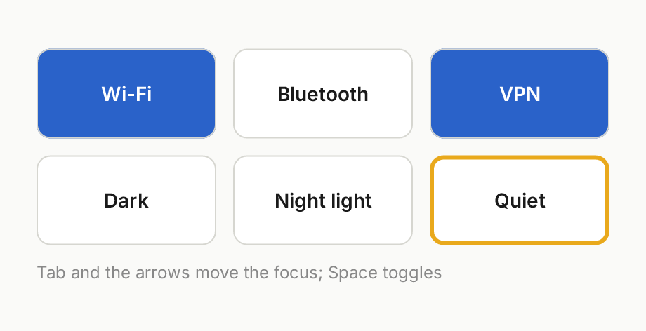

### Layouts and Repeater

Qt Quick Layouts: a `ColumnLayout` holds a heading `RowLayout` (a
filling `Item` pushes the button right), a `GridLayout` whose fields
take the width left over, a `Flow` of chips that wraps, and a `Grid`.
`Layout.fillWidth`, `preferredWidth`, `minimum*`, `maximum*`, the margins
and `alignment` share the room as Qt shares it. Each way is worked out
on its own, so a `Flow`'s height can follow the width its layout gives
it. The chips and swatches are a `Repeater`'s delegates, made from a
`list<string>` and from a count, with `modelData` and `index`; a
program's own `model<T>` (`tole::VecModel`, or any `tole::Model`) works
the same way and is followed as it changes.

```qml
// Layouts and Repeater: a ColumnLayout holding a heading row, a
// GridLayout of labelled fields that fill the width, a Flow of chips a
// Repeater makes from a list, and a Grid of swatches made from a count.
import Fx

component Field : Rectangle {
    property string value
    implicitHeight: 30
    radius: 6
    color: "white"
    border { width: 1; color: "#d6d6d0" }
    Text {
        anchors.left: parent.left; anchors.leftMargin: 10
        anchors.verticalCenter: parent.verticalCenter
        text: value
        font: font("Inter", 13, 400)
        color: "#1a1a1a"
    }
}

component Chip : Rectangle {
    property string label
    property bool on
    implicitWidth: caption.implicitWidth + 24
    implicitHeight: 26
    radius: 13
    color: on ? "#2a62c9" : "#ececE8"
    Text {
        id: caption
        anchors.centerIn: parent
        text: label
        font: font("Inter", 12, 500)
        color: on ? "white" : "#1a1a1a"
    }
}

component Label : Text {
    font: font("Inter", 13, 400)
    color: "#777777"
}

component Form : Rectangle {
    width: 520; height: 404
    color: "#fafaf8"

    ColumnLayout {
        anchors.fill: parent
        anchors.margins: 20
        spacing: 12

        RowLayout {
            Layout.fillWidth: true
            Text { text: "Network"; font: font("Inter", 20, 600); color: "#1a1a1a" }
            Item { Layout.fillWidth: true }
            Rectangle {
                implicitWidth: 76; implicitHeight: 30
                radius: 8
                color: "#2a62c9"
                Text { anchors.centerIn: parent; text: "Apply"; color: "white"; font: font("Inter", 13, 600) }
            }
        }

        GridLayout {
            Layout.fillWidth: true
            columns: 2
            columnSpacing: 12
            rowSpacing: 8
            Label { text: "Name" }
            Field { Layout.fillWidth: true; value: "home" }
            Label { text: "Address" }
            Field { Layout.fillWidth: true; value: "192.168.9.193/24" }
            Label { text: "Gateway" }
            Field { Layout.fillWidth: true; value: "192.168.9.1" }
        }

        Label { text: "Interfaces"; Layout.topMargin: 6 }
        Flow {
            Layout.fillWidth: true
            spacing: 8
            Repeater {
                model: ["eth0", "wlan0", "wg0", "docker0", "br-lan", "tailscale0", "virbr0", "lo"]
                Chip { label: modelData; on: index < 3 }
            }
        }

        Label { text: "Accent"; Layout.topMargin: 6 }
        Grid {
            columns: 12
            spacing: 6
            Repeater {
                model: 24
                Rectangle {
                    width: 30; height: 22
                    radius: 4
                    color: rgba(0.10 + index * 0.035, 0.38 + (index % 12) * 0.02, 0.85 - index * 0.025, 1)
                }
            }
        }

        Item { Layout.fillHeight: true }
    }
}
```

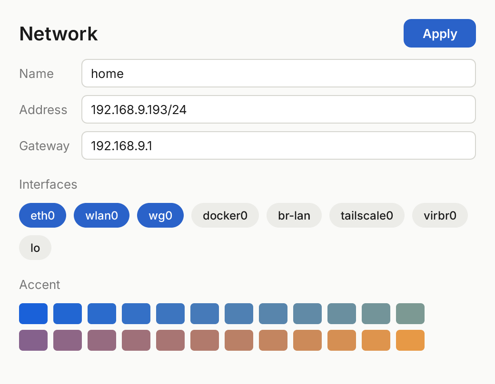

### A list of 100,000 rows

A `ListView` over a Rust model of 100,000 rows, two kinds of row chosen
by a `DelegateChooser` on the rows' `kind`. Only the rows in view have
delegates; scrolled out, a delegate goes to a pool of its kind and is
given the next row that needs one, so a screenful of them serves the
whole list (a test scrolls a thousand wheel steps and counts). Row
heights live in a Fenwick tree, so finding the row at an offset and
correcting a row measured differently both take `log n` steps. The
model makes a row only when it is shown; this one computes them, and
says its rows' heights so the view never guesses. The picture is
scrolled to row 50,000 with `positionViewAtIndex`. `followEnd` keeps
the last row at the view's foot as rows come, as `tail -f` does: it goes
on when the view is scrolled to its end, by anything, or is set, and off
only when something scrolls the view away from the end.

```qml
// A ListView of 100,000 rows from a Rust model, two kinds of row chosen
// by a DelegateChooser. Only the rows in view have delegates, recycled
// as it scrolls; the model makes a row only when it is shown.
import Fx

enum EntryKind { Record, Header }

struct Entry {
    kind: EntryKind
    level: int
    time: string
    source: string
    text: string
}

component Journal : Rectangle {
    property model<Entry> entries
    width: 600; height: 420
    color: "#fafaf8"

    Rectangle {
        id: bar
        width: parent.width; height: 46
        color: "white"
        Text { x: 18; anchors.verticalCenter: parent.verticalCenter; text: "Journal"; font: font("Inter", 17, 600); color: "#1a1a1a" }
        Text {
            anchors.right: parent.right; anchors.rightMargin: 18
            anchors.verticalCenter: parent.verticalCenter
            text: "${group(list.count)} entries"
            font: font("Inter", 12, 400)
            color: "#888888"
        }
        Rectangle { y: parent.height - 1; width: parent.width; height: 1; color: "#e6e6e2" }
    }

    ListView {
        id: list
        anchors.top: bar.bottom; anchors.bottom: parent.bottom
        anchors.left: parent.left; anchors.right: parent.right
        clip: true
        model: entries
        delegate: DelegateChooser {
            role: "kind"
            DelegateChoice {
                roleValue: EntryKind.Header
                Rectangle {
                    width: parent.width; height: 34
                    color: "#f0f0ec"
                    Text { x: 18; anchors.verticalCenter: parent.verticalCenter; text: modelData.text; font: font("Inter", 12, 600); color: "#555555" }
                }
            }
            DelegateChoice {
                roleValue: EntryKind.Record
                Rectangle {
                    width: parent.width; height: 24
                    color: modelData.level <= 3 ? "#fbe9e7" : modelData.level == 4 ? "#fdf4e0" : "transparent"
                    Text { x: 18; anchors.verticalCenter: parent.verticalCenter; text: modelData.time; font: font("Inter", 12, 400); color: "#999999" }
                    Text {
                        x: 92; width: 96; anchors.verticalCenter: parent.verticalCenter
                        text: modelData.source; elide: Text.ElideRight
                        font: font("Inter", 12, 500)
                        color: modelData.level <= 3 ? "#c62828" : "#2a62c9"
                    }
                    Text {
                        x: 196; width: parent.width - 212; anchors.verticalCenter: parent.verticalCenter
                        text: modelData.text; elide: Text.ElideRight
                        font: font("Inter", 12, 400)
                        color: "#1a1a1a"
                    }
                }
            }
        }
    }
}
```

The model, in the demo's Rust:

```rust
impl tole::Model for JournalRows {
    type Row = Entry;                       // the markup's struct
    fn row_count(&self) -> usize { 100_000 }
    fn row(&self, index: usize) -> Option<Entry> { /* made on demand */ }
    fn row_height(&self, index: usize) -> Option<f32> {
        Some(if index.is_multiple_of(40) { 34.0 } else { 24.0 })
    }
    fn tracker(&self) -> &tole::ModelTracker { &self.tracker }
}
```

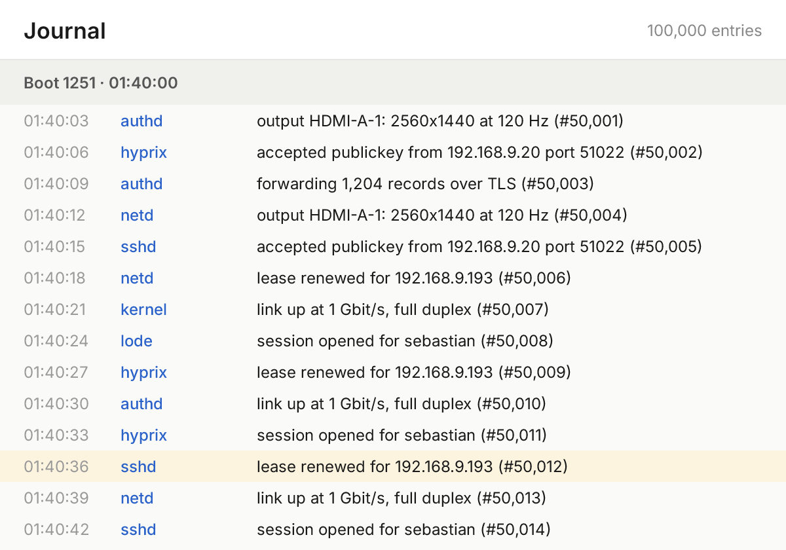

### States, transitions and animations

`states` with `when` and `PropertyChanges`, a `Transition` animating
what a change of state moves, `Behavior on x` animating every change,
and `SequentialAnimation`/`ParallelAnimation`/`PauseAnimation` with
`NumberAnimation` and `ColorAnimation` on a property, `loops` and
`running`, along Qt's easing curves. The clock is the window's frames;
the tests and these pictures tick it by hand, so they are exact. The
picture is a second after the switch was clicked; below it, the demo
played (an animated PNG, drawn the same way: the switch on, then off).

```qml
// States, transitions and animations. The switch's knob and colour
// follow it through Behaviors; the card has a state, "open", that the
// switch turns on, and a Transition slides its panel in and tints the
// card when the state changes. The dot pulses for ever: a
// SequentialAnimation on its opacity.
import Fx

component Switch : Rectangle {
    id: switcher
    property bool on
    width: 52; height: 30
    radius: 15
    color: on ? "#2a62c9" : "#c9c9c4"
    Behavior on color { ColorAnimation { duration: 180 } }
    Rectangle {
        x: switcher.on ? 25 : 3; y: 3
        width: 24; height: 24
        radius: 12
        color: "white"
        Behavior on x { NumberAnimation { duration: 180; easing.type: Easing.OutCubic } }
    }
    MouseArea { anchors.fill: parent; onClicked: switcher.on = !switcher.on }
}

component Transitions : Rectangle {
    width: 480; height: 300
    color: "#fafaf8"

    Text { x: 24; y: 28; text: "Details"; font: font("Inter", 18, 600); color: "#1a1a1a" }
    Switch { id: toggle; x: 404; y: 24 }

    Rectangle {
        id: card
        x: 24; y: 76; width: 432; height: 200
        radius: 12
        color: "white"
        border { width: 1; color: "#e6e6e2" }
        clip: true

        Text { x: 20; y: 22; text: toggle.on ? "Shown in full" : "Folded"; font: font("Inter", 15, 600); color: "#1a1a1a" }
        Rectangle {
            x: 20; y: 60; width: 12; height: 12
            radius: 6
            color: "#2fa35a"
            SequentialAnimation on opacity {
                loops: Animation.Infinite
                NumberAnimation { to: 0.2; duration: 700; easing.type: Easing.InOutSine }
                NumberAnimation { to: 1; duration: 700; easing.type: Easing.InOutSine }
            }
        }
        Text { x: 40; y: 57; text: "live"; font: font("Inter", 13, 400); color: "#777777" }

        Rectangle {
            id: panel
            x: 440; y: 12; width: 200; height: 176
            radius: 10
            color: "#14306a"
            Text { x: 18; y: 18; text: "The panel"; font: font("Inter", 15, 600); color: "white" }
            Text { x: 18; y: 44; text: "slid in by a Transition"; font: font("Inter", 12, 400); color: "#b8c8ec" }
        }
    }

    states: [
        State {
            name: "open"
            when: toggle.on
            PropertyChanges { target: panel; x: 220 }
            PropertyChanges { target: card; color: "#eef3fc" }
        }
    ]
    transitions: [
        Transition {
            NumberAnimation { properties: "x"; duration: 500; easing.type: Easing.OutBack }
            ColorAnimation { duration: 500 }
        }
    ]
}
```

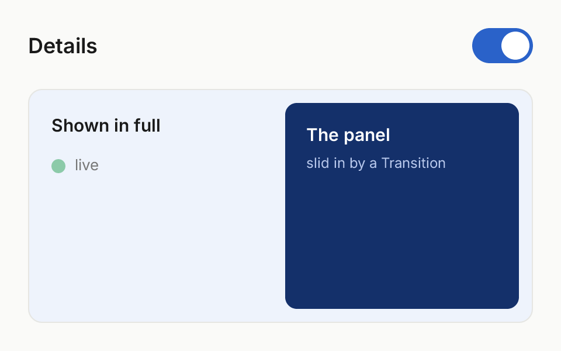

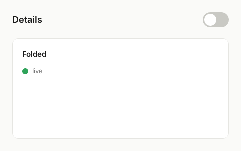

### Controls and the theme

`import Fx.Controls` brings the framework's controls: `Button`,
`CheckBox`, `RadioButton`, `Switch`, `Label`, `ProgressBar`, `TabBar`,
`GroupBox`, `TextField`, `TextArea`, `ComboBox`, `Menu` with `MenuItem`
and `MenuSeparator`, `ScrollBar`, `FileIcon` and `FileDialog`, each a `.tole` file
inside the compiler, written on the primitives as Qt Quick Controls are
in QML. There is one style;
every colour, radius and face in it is a token of the `Theme`
singleton, the lode viewer's palette in light and dark. Setting
`Theme.dark` (from markup, or from Rust:
`fx_controls::Theme::instance(&mut ui).dark.set(&mut ui, true)`)
switches every token, and every control with them; a program gives its
own accent the same way. The two pictures are the same file, drawn
with `Theme.dark` false and true, after a double click on "nazuna" in
the first field.

```qml
// Fx.Controls in one window: every control in the style's one look, its
// colours the Theme's tokens. The same file is drawn light and dark; only
// `Theme.dark` differs.
import Fx
import Fx.Controls

component Controls : Rectangle {
    width: 700; height: 520
    color: Theme.bg2

    TabBar {
        id: tabs
        x: 20; y: 12
        tabs: ["Controls", "Text", "Lists"]
    }

    Row {
        x: 20; y: 66
        spacing: 16
        GroupBox {
            title: "BUTTONS"
            Button { text: "Save"; highlighted: true }
            Button { text: "Cancel" }
            Button { text: "Flat"; flat: true }
            Button { text: "Disabled"; enabled: false }
        }
        GroupBox {
            title: "CHOICES"
            CheckBox { text: "Follow live"; checked: true }
            CheckBox { text: "Wrap lines" }
            Column {
                spacing: 6
                RadioButton { text: "Light" }
                RadioButton { text: "Dark"; checked: true }
                RadioButton { text: "System" }
            }
            Switch { text: "Notifications"; checked: true }
            Switch { text: "Quiet hours" }
        }
        Column {
            spacing: 16
            GroupBox {
                title: "TEXT"
                TextField { id: host; width: 200; text: "nazuna.local" }
                TextField { width: 200; placeholderText: "Passphrase"; echoMode: TextInput.Password; text: "hunter22" }
                TextField { width: 200; placeholderText: "Search the log" }
                TextArea { width: 200; text: "Lines break at the width, between words." }
                ComboBox { width: 200; model: ["Every boot", "This boot", "The last hour"] }
            }
            GroupBox {
                title: "PROGRESS"
                Label { text: "Indexing 3 of 4 boots" }
                ProgressBar { width: 200; value: 0.62 }
            }
        }
    }
}
```

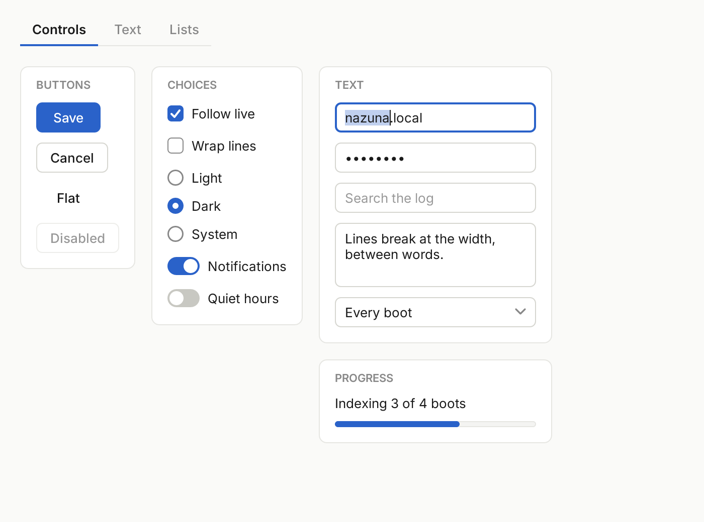

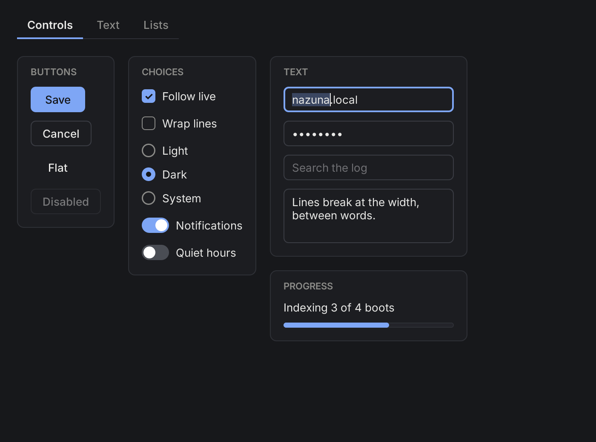

What made them possible in the markup:

* **Modules.** A file sees its own declarations first, then what it
  imports, then the rest of the program's, so a program's own `Button`
  and the controls' never meet; an imported module is written out as a
  Rust module of its own (`fx_controls`).
* **`singleton`s**: one object per `Ui`, of properties and functions,
  reached by its name (`Theme.ink`, `Theme.sans(13, 500)`).
* **Aliases**: `property alias text: label.text` is the label's own
  property cell, so a change either way is seen both ways, and `default
  property alias content: column` says where a use's children go, as
  `GroupBox` does.
* **Parameters with defaults**: `Theme.sans()` is 13 px, regular.
* **`Exclusive.checked: checked`**: among the items beside each other
  that say it, one is checked at a time, as radio buttons are.

The text fields stand on two primitives, `TextInput` (one line,
scrolled across to keep the caret in view) and `TextEdit` (lines,
broken between words at its width): a caret, a selection by the pointer
(a double click takes a word, a third click the line) and by Shift with
the arrows, Home and End, word moves with Control, and Ctrl+A, Ctrl+C,
Ctrl+X and Ctrl+V. A letter is typed only with neither Control nor Alt
held. In a window, copies and pastes go through the desktop's clipboard
(`ext_data_control_v1`, which hyprix offers); without one, the `Ui`
keeps its last copy itself. A password (`echoMode: TextInput.Password`)
shows dots and is never copied. Ctrl+Z undoes an edit (letters typed in
a row go back as one word) and Ctrl+Shift+Z or Ctrl+Y redoes it; the
focused field's caret blinks from its last move and stays lit after ten
seconds untouched, so an idle window stops drawing; and a `TextArea`
scrolls to keep its caret's line in view as one types or moves.

### Popups, menus, a split and a file chooser

A `Popup` is drawn over everything in the window and takes the pointer
first while it is shown, placed from its parent but outside any cut
around it. A press outside closes it (and does nothing else, so the
press that closes a menu clicks nothing under it), as Escape does; a
`Menu` also closes once an item is clicked. A `ComboBox` opens its list
in one. A modal popup takes the keys when it opens, and a combo box's
list is given them; however a popup closes -- `close()`, Escape, a press outside,
its `visible` set or the popup destroyed -- the keys go back to where
they were, if they were still inside it. A `SplitView` places its children as a `RowLayout` does, and
the handle between two drags the first one's `Layout.preferredWidth`.
A `ScrollBar` is bound to what it scrolls and says `moved` when dragged.
The picture is after a click on the combo box, the menu opened by the
program and the pointer resting on "Copy cursor".

```qml
// Over everything: a ComboBox's list and a Menu, open, and a SplitView
// whose left side is a list with a ScrollBar. The handle between the
// two sides drags; the list scrolls by the wheel or the bar.
import Fx
import Fx.Controls

component Popups : Rectangle {
    width: 720; height: 420
    color: Theme.bg2

    SplitView {
        anchors.fill: parent
        handleColor: Theme.line

        Rectangle {
            Layout.preferredWidth: 220
            Layout.minimumWidth: 120
            color: Theme.bg
            ListView {
                id: boots
                x: 0; y: 8
                width: parent.width - 12
                height: parent.height - 16
                model: 40
                delegate: Rectangle {
                    width: boots.width
                    height: 28
                    color: index == 3 ? Theme.accentBg : "transparent"
                    Text {
                        x: 14
                        height: parent.height
                        text: "Boot ${index + 1}"
                        font: Theme.sans(13, index == 3 ? 600 : 400)
                        color: Theme.ink
                    }
                }
            }
            ScrollBar {
                anchors.right: parent.right
                y: 8
                height: parent.height - 16
                size: boots.height / boots.contentHeight
                position: boots.contentY / boots.contentHeight
                onMoved: boots.contentY = position * boots.contentHeight
            }
        }
        Item {
            Layout.fillWidth: true
            Column {
                x: 24; y: 24
                spacing: 12
                Label { text: "Machine"; font: Theme.sans(11, 600); color: Theme.ink4 }
                ComboBox {
                    id: machine
                    width: 220
                    model: ["nazuna", "pixel7", "dk1", "n150"]
                    currentIndex: 1
                }
            }
            Button {
                id: more
                x: 250; y: 52
                text: "Actions"
                onClicked: actions.open()
            }
            Menu {
                id: actions
                x: 250; y: 88
                MenuItem { text: "Copy record"; shortcut: "Ctrl+C" }
                MenuItem { text: "Copy cursor" }
                MenuSeparator { }
                MenuItem { text: "Open in new window"; shortcut: "Ctrl+N" }
                MenuItem { text: "Forget machine"; enabled: false }
            }
        }
    }
}
```

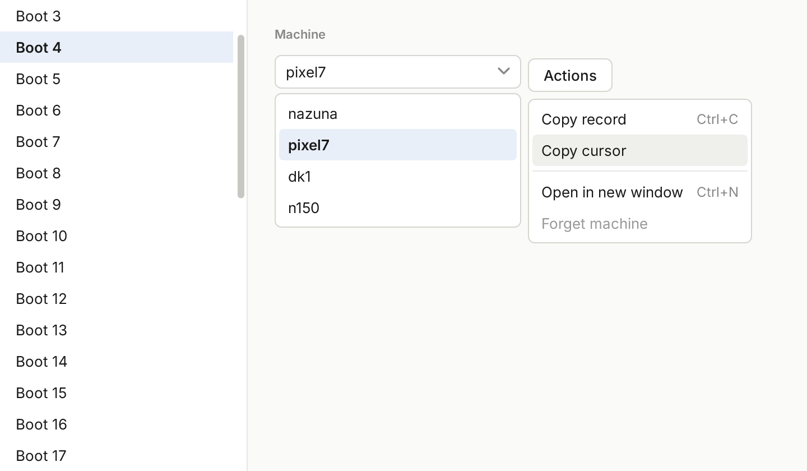

### The file chooser

`FileDialog` is the chooser every tole program gets (the customer's
"Key File Dialog" design): a modal dialog in the window, which takes the
keys while it is open and gives them back when it closes. It shows the
folder as a list (name, kind, size, when it changed) or a grid with
thumbnails, with Up, breadcrumbs and places down the side; a preview of
the file chosen -- the start of a text file, a picture, a folder's
names, and a private key's first and last lines with its contents
hidden; and a line at its foot saying what is chosen, or why it cannot
be (a public key: "use the file without .pub").

It takes what `acceptedTypes` says, a pattern: parts separated by `|`
or `,`, `*` any text and `?` one character against the whole name, case
aside, and `[kind]` by kind -- `image`, `private`, `public`, `text`,
`archive`, `video`, `audio`, `document`, `folder`; a key is told by its
first line, not its name. The filter at its foot shows only those, all
files (the rest dimmed, and refused), or a pattern of one's own. The
search reads its text in three modes, chosen from the menu in its
field: the name contains it; a pattern as above; or a regular
expression found in the name (`^id_.*$`, the compositor's RE2-like
matcher). A pattern or expression that cannot be read says why in red,
with how to write one. The keys: Up and Down move, Return opens a folder
or chooses a file, Backspace goes up, Escape cancels.

```qml
// The file chooser as the lode viewer's "Add machine" asks for a key: it
// takes private keys, opens in ~/.ssh, and its places are where keys are
// kept.
component Chooser : Rectangle {
    width: 1000; height: 700
    color: Theme.bg2
    Label { x: 28; y: 22; text: "Add machine"; font: Theme.sans(24, 700); color: Theme.ink4 }
    FileDialog {
        id: chooser
        anchors.centerIn: parent
        title: "Choose the key file"
        acceptedTypes: "[private]"
        acceptedLabel: "Private keys"
        acceptedNoun: "private keys"
        openLabel: "Use key"
        folder: "~/.ssh"
        placeNames: ["Home", "Machine keys", ".ssh", "Downloads", "Pictures"]
        placePaths: ["~", "~/machines/keys", "~/.ssh", "~/Downloads", "~/Pictures"]
    }
}
```

Dark, in `~/machines/keys` with a key chosen; light, `~/Pictures` as a
grid under "All files", a picture chosen and refused. The folders are a
home made for the pictures under the temporary folder, its clock fixed,
so they do not change with the day they are drawn.

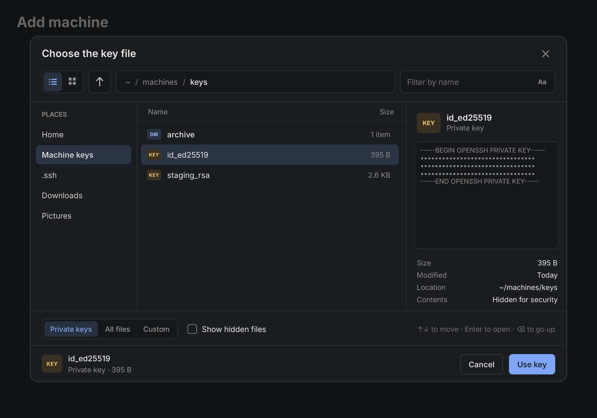

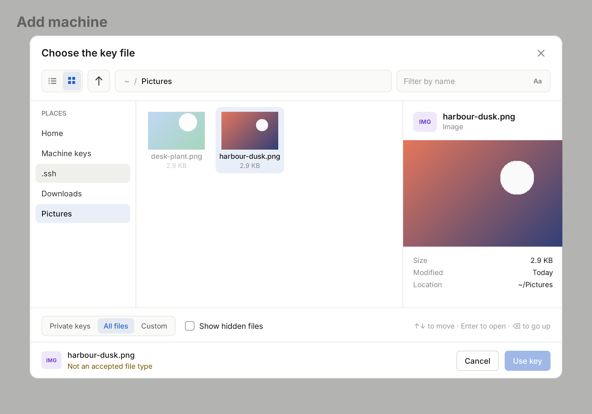

`accepted(path)` says the file chosen, `rejected()` a cancel; the rest
of its API is `title`, `folder`, `showHidden`, `acceptedTypes`,
`acceptedLabel` and `acceptedNoun` (how the filter and the hints name
them), `placeNames` and `placePaths`, `openLabel`, `typeFilter`,
`customPattern`, `gridView`, `searchText`, `searchMode`, and
`selectedFile`. A wallpaper picker is
`acceptedTypes: "[image]"`, `acceptedLabel: "Pictures"`, `gridView:
true`.

It is built in markup on three things a file manager uses too:

* **`FolderListModel`** reads a folder once and filters and sorts what
  it read without reading it again: `nameFilter` and `filterMode`
  (`FolderListModel.Basic`, `Advanced`, `Regex`), `accept` and
  `acceptedOnly`, `sortField` (`Name`, `Size`, `Time`, `Type`) and
  `sortReversed`, `revision` to read it again; it says `count`,
  `totalSize`, `crumbs`, `displayPath`, `filterError` and `acceptError`,
  and `current`, the row at `currentIndex`. Each row has `name`, `path`,
  `isDir`, `size`, `sizeText`, `modified`, `kind`, `kindLabel`, `badge`,
  `hidden`, `accepted`, `isImage` and, for a folder, `items`.
* **`FileInfo`**: one file as a preview shows it -- its `entry`, its
  `location`, the `text` shown of it (never a private key's contents),
  and the `refusal` for an `accept` pattern that does not take it.
* **`Image`**: a PNG, JPEG or SVG file drawn (`compositor-image`'s
  decoders), `Image.Stretch`, `PreserveAspectFit` or
  `PreserveAspectCrop`, decoded once at the pixels it covers and kept.

`FileIcon` is the three-letter badge of a kind, in its colour.

### Charts and shapes

A `Canvas` is painted by a Rust function the program gives it, handed a
`Painter` in the canvas's own coordinates (rectangles, paths, lines,
text): charts are loops over data, which is Rust's work. A `Shape` holds
fixed figures written in the markup, `ShapePath`s of `PathLine`,
`PathQuad` and `PathCubic` with a fill and a stroke, bound like any
property.

```qml
// Charts as Canvas painters, which are Rust functions over the data:
// a histogram, a sparkline and an area. And fixed figures as Shapes,
// written here: a play triangle, a check mark, a skip mark.
import Fx
import Fx.Controls

component Charts : Rectangle {
    property painter histogram
    property painter sparkline
    property painter area
    width: 700; height: 330
    color: Theme.bg2

    Row {
        x: 20; y: 20
        spacing: 16
        GroupBox {
            title: "RECORDS PER MINUTE"
            Canvas { width: 300; height: 150; painter: histogram }
            Label { text: "14,213 records in the last hour"; color: Theme.ink4 }
        }
        Column {
            spacing: 16
            GroupBox {
                title: "ERRORS, LAST HOUR"
                Row {
                    spacing: 12
                    Canvas { width: 180; height: 36; painter: sparkline }
                    Label { text: "3 / min"; font: Theme.sans(15, 600); anchors.verticalCenter: parent.verticalCenter }
                }
            }
            GroupBox {
                title: "MEMORY IN USE"
                Canvas { width: 268; height: 80; painter: area }
            }
        }
    }

    Row {
        x: 20; y: 280
        spacing: 20
        Shape {
            // The boot picker's triangle.
            ShapePath {
                fillColor: Theme.accent
                strokeColor: "transparent"
                startX: 0; startY: 0
                PathLine { x: 18; y: 10 }
                PathLine { x: 0; y: 20 }
                closed: true
            }
        }
        Shape {
            ShapePath {
                strokeColor: Theme.green
                strokeWidth: 3
                startX: 2; startY: 11
                PathLine { x: 8; y: 17 }
                PathLine { x: 20; y: 3 }
            }
        }
        Shape {
            // A skip mark: two chevrons, the second a curve.
            ShapePath {
                strokeColor: Theme.ink3
                strokeWidth: 2
                startX: 2; startY: 2
                PathLine { x: 10; y: 10 }
                PathLine { x: 2; y: 18 }
            }
            ShapePath {
                strokeColor: Theme.ink3
                strokeWidth: 2
                startX: 12; startY: 2
                PathQuad { controlX: 24; controlY: 10; x: 12; y: 18 }
            }
        }
    }
}
```

```rust
let root = Charts::new(&mut ui, None)?;
root.sparkline.set(&mut ui, tole::CanvasPainter::new(move |p| {
    let (w, h) = p.size();
    let mut path = tole::Path::new();
    for (i, v) in errors.iter().enumerate() {
        let (x, y) = (w * i as f32 / (errors.len() - 1) as f32, h - 2.0 - (h - 4.0) * v);
        let _ = if i == 0 { path.move_to(x, y) } else { path.line_to(x, y) };
    }
    p.path(&path, tole::Color::TRANSPARENT, red, 1.5);
}));
// When the data changes: ui.update_canvas(canvas_item);
```

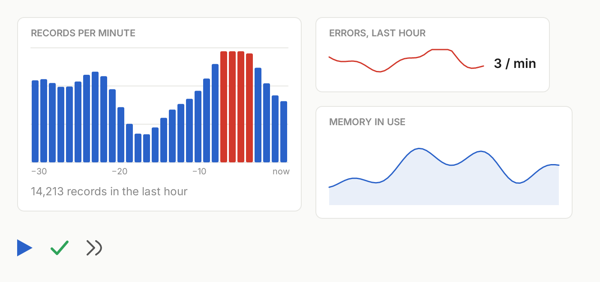

### In a window

Every demo also runs in a window on the Wayland desktop it is started
on -- Ferrix's hyprix, or any other: tole's `wayland` feature opens a
toplevel through Ferrix's own Wayland client runtime, pure Rust over the
socket, with no libwayland.

```sh
cargo run -p tole-examples -- counter --window
```

On Ferrix, `cargo xtask test-compositor --boot tole-demo` boots an image
whose desktop starts the controls demo in a window, and checks the
screen shows it.

Only what changed is drawn again: a frame is kept between draws, each
item's drawing is compared with the last frame's, and the damaged parts
alone are drawn and handed to the compositor. A test holds the kept
frame to what drawing the whole scene gives, pixel for pixel, as a
rounded box wanders at scales 1, 1.5 and 2.

### The lode viewer

Ferrix's log viewer (`lode-viewer`, in Ferrix's apps) is a tole program:
its header, sidebar, pages, forms and menus are `.tole` files, its
charts and swim lanes Rust painters, and its table a `ListView` over a
Rust model of the log, made only for the rows in view, so a hundred
thousand records scroll as a screenful does. Ported from its own
immediate drawing, it draws the same pixels as before, but for the
antialiasing of a few edges. Here, Logs with a query and a record open,
drawn by its `--render`:

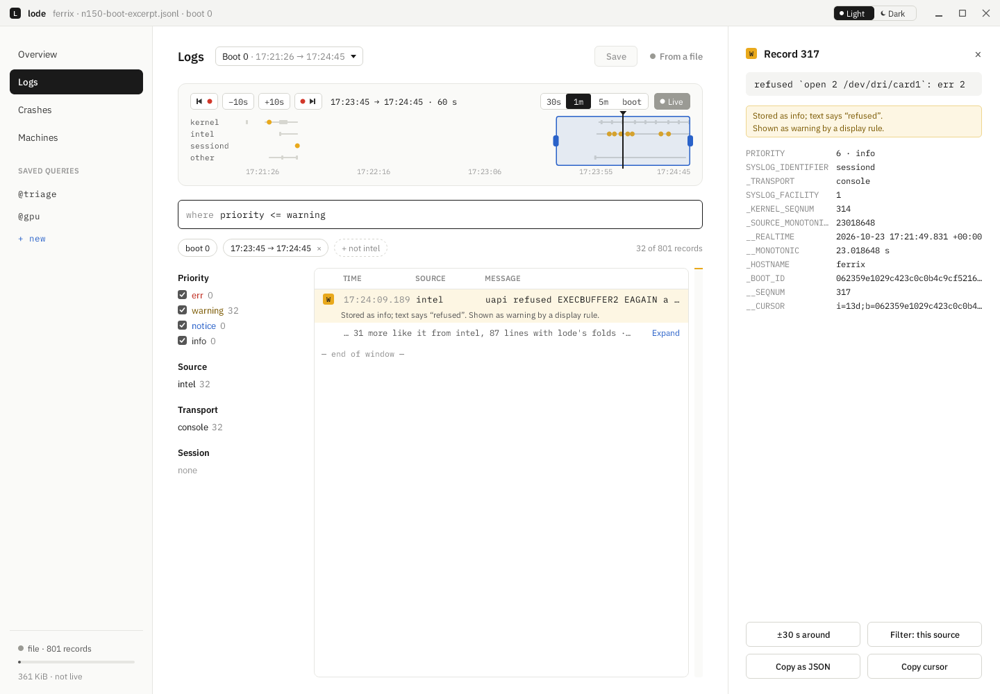

## Crates

* **`tole`**: the runtime. Property cells and bindings with dependency
  tracking, the item tree (`Item`, `Rectangle`, `Text`, `Row`, `Column`,
  `MouseArea`, `FocusScope`), `Grid`, `Flow`, `RowLayout`,
  `ColumnLayout`, `GridLayout` with `Layout.*`, `Repeater` and models,
  `Flickable`, `ListView` with virtualization, recycling and
  `DelegateChooser`, states, transitions, `Behavior` and animations on
  a frame clock,
  signals and handlers, the pointer's routing, focus, keys and the Tab
  order, damage and
  partial redraw into a kept `Frame`, the window (`wayland` feature),
  anchors, the scene as drawing operations, the `Renderer` trait and the
  CPU renderer, typed handles for each kind of item, and `include_ui!` for
  the compiler's output.
* **`tole-compiler`**: `.tole` files parsed, type-checked and written out
  as Rust from a program's `build.rs` (`tole_compiler::build("ui")`), put
  in place with `tole::include_ui!()`. Errors name the file, line and
  column. It is a build dependency only: nothing of it is in a program.
  The framework's modules (`Fx.Controls`, under `modules/`) are `.tole`
  files inside it, compiled with the program's.
* **`tole-examples`** (`examples/`): the demos above.

## Building

tole is a component of [Ferrix](https://github.com/ferrix-os/ferrix): a
Ferrix tree checks it out at `src/user/system/linux/tole`
(`components.toml`), beside the compositor's workspace, and tole reaches
two of the compositor's crates by path from there: `text` (fonts, shaping
and glyphs, pure Rust over ttf-parser and rustybuzz) and, for the window
backend behind its `wayland` feature, `toolkit` (the Wayland client
runtime, pure Rust over the socket). Its tests draw with the tree's own
Inter from `assets/fonts`.

So to build it alone, put it where a Ferrix tree would:

```sh
git clone --filter=blob:none --sparse https://github.com/ferrix-os/ferrix
cd ferrix
git sparse-checkout set src/user/system/linux/compositor assets/fonts/inter
git clone https://github.com/ferrix-os/tole src/user/system/linux/tole
cd src/user/system/linux/tole
cargo test
```

which is what CI does. Inside a Ferrix tree, `cargo xtask check` runs
tole's formatting, clippy and tests with everything else.

## Changing it

A change to tole is two landings, as for every Ferrix component (Ferrix's
`docs/CONVENTIONS.md`, "Components live in repositories of their own"):
commit and push here, then pin the commit in Ferrix with `cargo xtask
pin-components` and land that. Commits name one author: no
`Co-authored-by:` trailer and no tool signature; CI refuses them.

## Licence

MIT, as Ferrix's compositor.
