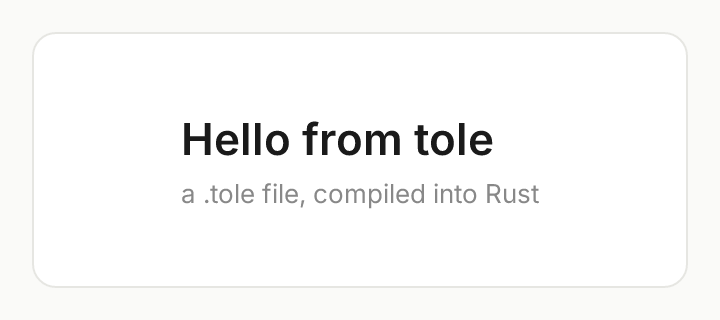
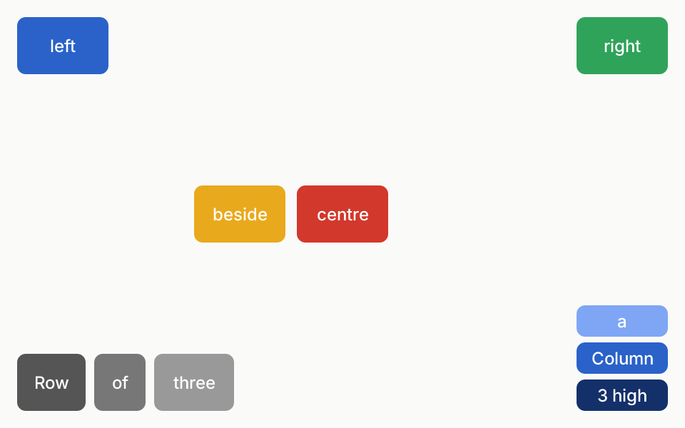
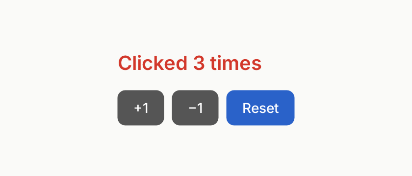

# tole

Ferrix's UI framework, after Qt Quick and QML: a retained tree of items
with typed properties and bindings, anchors and layouts, drawn on the CPU
with tiny-skia and Ferrix's own text, with a GPU path to come. Its markup,
`.tole` files, is compiled into Rust when a program is built, so a program
carries no interpreter.

The design, the plan and where it stands are in Ferrix's
[`docs/UI-FRAMEWORK.md`](https://github.com/ferrix-os/ferrix/blob/develop/docs/UI-FRAMEWORK.md).

## Demos

Each is a `.tole` file in [`examples/ui`](examples/ui), compiled by the
examples' `build.rs` and drawn headless on the CPU at scale 2. The
pictures below are those drawings: `cargo run -p tole-examples -- --all
docs/screenshots` writes them, and a test fails (in CI too) when one no
longer matches what its demo draws, so they cannot go stale.

### Hello

```qml
// The smallest program: a card with two lines of text, centred.
import Fx

component Hello : Rectangle {
    width: 360; height: 160
    color: "#fafaf8"

    Rectangle {
        anchors.fill: parent
        anchors.margins: 16
        radius: 12
        color: "white"
        border { width: 1; color: "#e6e6e2" }

        Column {
            anchors.centerIn: parent
            spacing: 6
            Text { text: "Hello from tole"; font: font("Inter", 22, 600); color: "#1a1a1a" }
            Text { text: "a .tole file, compiled into Rust"; font: font("Inter", 13, 400); color: "#888888" }
        }
    }
}
```



### Layouts

Every place is a binding: anchors to the window and to a sibling, a `Row`
and a `Column`. Resize the window and everything follows.

```qml
// Anchors, a Row and a Column: every place here is a binding, so resizing
// the window moves everything with it.
import Fx

component Swatch : Rectangle {
    property string label
    width: 64; height: 40
    radius: 6
    Text {
        anchors.centerIn: parent
        text: label
        font: font("Inter", 12, 500)
        color: "white"
    }
}

component Layouts : Rectangle {
    width: 480; height: 300
    color: "#fafaf8"

    // A corner each, anchored to the window.
    Swatch { label: "left"; color: "#2a62c9"; anchors.left: parent.left; anchors.top: parent.top; anchors.margins: 12 }
    Swatch { label: "right"; color: "#2fa35a"; anchors.right: parent.right; anchors.top: parent.top; anchors.margins: 12 }
    Swatch { id: middle; label: "centre"; color: "#d2382b"; anchors.centerIn: parent }
    // Beside the middle one, its right edge on the middle's left edge.
    Swatch { label: "beside"; color: "#e9a91c"; anchors.right: middle.left; anchors.rightMargin: 8; anchors.verticalCenter: middle.verticalCenter }

    Row {
        anchors.left: parent.left; anchors.bottom: parent.bottom; anchors.margins: 12
        spacing: 6
        Swatch { label: "Row"; color: "#555555"; width: 48 }
        Swatch { label: "of"; color: "#777777"; width: 36 }
        Swatch { label: "three"; color: "#999999"; width: 56 }
    }

    Column {
        anchors.right: parent.right; anchors.bottom: parent.bottom; anchors.margins: 12
        spacing: 4
        Swatch { label: "a"; color: "#7ea6f5"; height: 22 }
        Swatch { label: "Column"; color: "#2a62c9"; height: 22 }
        Swatch { label: "${2 + 1} high"; color: "#14306a"; height: 22 }
    }
}
```



### Counter

Signals and handlers. A button is a component with a `clicked` signal,
and each use of it says what a click does; its colour is a binding on its
`MouseArea`'s `pressed` and `containsMouse`. The picture is after three
clicks on +1, with the pointer resting on Reset; the demo's script works
the buttons through the same pointer calls a window feeds.

```qml
// Signals and handlers: a button is a component with a `clicked`
// signal, and each use says what a click does. Its colour is a binding on
// its MouseArea's `pressed` and `containsMouse`.
import Fx

component Button : Rectangle {
    id: button
    property string label
    signal clicked()

    width: caption.implicitWidth + 32
    height: 36
    radius: 8
    color: area.pressed ? "#14306a" : area.containsMouse ? "#2a62c9" : "#555555"

    Text {
        id: caption
        anchors.centerIn: parent
        text: label
        color: "white"
        font: font("Inter", 14, 500)
    }
    MouseArea {
        id: area
        anchors.fill: parent
        hoverEnabled: true
        // `clicked()` alone would be the MouseArea's own, as in QML.
        onClicked: button.clicked()
    }
}

component Counter : Rectangle {
    property int count
    width: 420; height: 180
    color: "#fafaf8"

    Column {
        anchors.centerIn: parent
        spacing: 16
        Text {
            text: count == 1 ? "Clicked once" : "Clicked ${count} times"
            font: font("Inter", 20, 600)
            color: count >= 3 ? "#d2382b" : "#1a1a1a"
        }
        Row {
            spacing: 8
            Button { label: "+1"; onClicked: count = count + 1 }
            Button { label: "−1"; onClicked: if (count > 0) { count = count - 1 } }
            Button { label: "Reset"; onClicked: count = 0 }
        }
    }
}
```



The program's Rust is not called back: it reads what was emitted, after
it hands the `Ui` an event, through an enum the compiler writes for each
component that declares signals.

```rust
let button = Button::new(&mut ui, None)?;
ui.pointer_move(x, y);
ui.pointer_press();
ui.pointer_release();
for emitted in ui.take_signals() {
    if let Some(ButtonSignal::Clicked) = button.signal(&emitted) {
        // ...
    }
}
```

### In a window

Every demo also runs in a window on the Wayland desktop it is started
on -- Ferrix's hyprix, or any other: tole's `wayland` feature opens a
toplevel through Ferrix's own Wayland client runtime, pure Rust over the
socket, with no libwayland.

```sh
cargo run -p tole-examples -- counter --window
```

Only what changed is drawn again: a frame is kept between draws, each
item's drawing is compared with the last frame's, and the damaged parts
alone are drawn and handed to the compositor. A test holds the kept
frame to what drawing the whole scene gives, pixel for pixel, as a
rounded box wanders at scales 1, 1.5 and 2.

More come as the framework reaches them: controls, a 100,000-row list,
states and transitions, the theme in light and dark, a chart, and the lode
viewer ported onto tole.

## Crates

* **`tole`**: the runtime. Property cells and bindings with dependency
  tracking, the item tree (`Item`, `Rectangle`, `Text`, `Row`, `Column`,
  `MouseArea`), signals and handlers, the pointer's routing, damage and
  partial redraw into a kept `Frame`, the window (`wayland` feature),
  anchors, the scene as drawing operations, the `Renderer` trait and the
  CPU renderer, typed handles for each kind of item, and `include_ui!` for
  the compiler's output.
* **`tole-compiler`**: `.tole` files parsed, type-checked and written out
  as Rust from a program's `build.rs` (`tole_compiler::build("ui")`), put
  in place with `tole::include_ui!()`. Errors name the file, line and
  column. It is a build dependency only: nothing of it is in a program.
* **`tole-examples`** (`examples/`): the demos above.

## Building

tole is a component of [Ferrix](https://github.com/ferrix-os/ferrix): a
Ferrix tree checks it out at `src/user/system/linux/tole`
(`components.toml`), beside the compositor's workspace, and tole reaches
two of the compositor's crates by path from there: `text` (fonts, shaping
and glyphs, pure Rust over ttf-parser and rustybuzz) and, for the window
backend behind its `wayland` feature, `toolkit` (the Wayland client
runtime, pure Rust over the socket). Its tests draw with the tree's own
Inter from `assets/fonts`.

So to build it alone, put it where a Ferrix tree would:

```sh
git clone --filter=blob:none --sparse https://github.com/ferrix-os/ferrix
cd ferrix
git sparse-checkout set src/user/system/linux/compositor assets/fonts/inter
git clone https://github.com/ferrix-os/tole src/user/system/linux/tole
cd src/user/system/linux/tole
cargo test
```

which is what CI does. Inside a Ferrix tree, `cargo xtask check` runs
tole's formatting, clippy and tests with everything else.

## Changing it

A change to tole is two landings, as for every Ferrix component (Ferrix's
`docs/CONVENTIONS.md`, "Components live in repositories of their own"):
commit and push here, then pin the commit in Ferrix with `cargo xtask
pin-components` and land that. Commits name one author: no
`Co-authored-by:` trailer and no tool signature; CI refuses them.

## Licence

MIT, as Ferrix's compositor.
